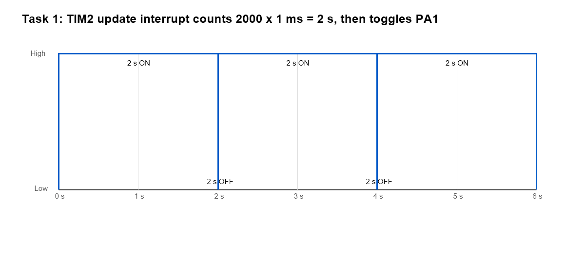
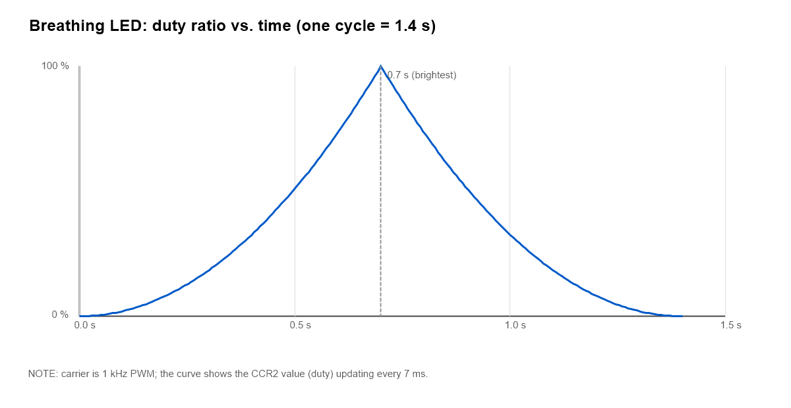
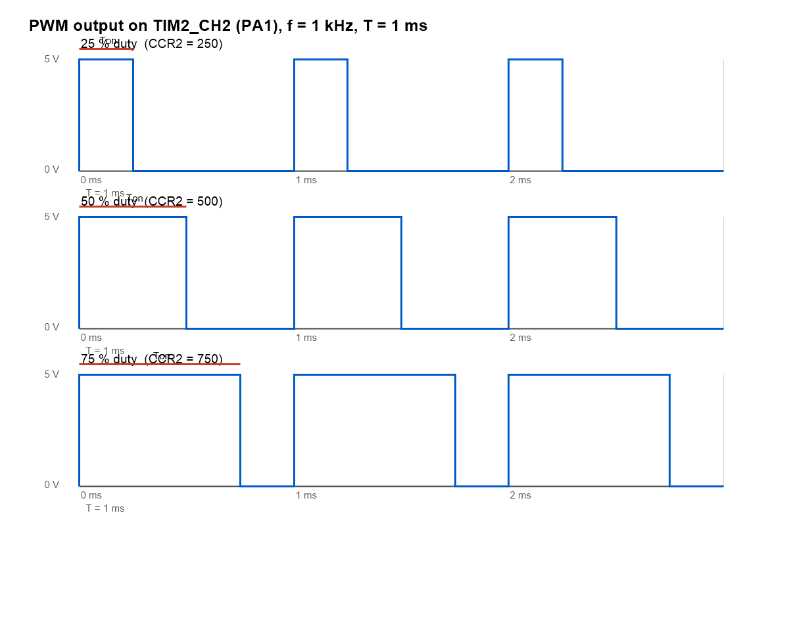

# STM32 定时器与 PWM 实验报告

> 课程作业：第 4-5 周作业 —— 定时器和 PWM
> 开发板：STM32F103C8T6 最小系统板
> 工程名：`Timer_PWM_Task`

---

## 一、实验目的

1. 深入了解 STM32 通用定时器（TIM2~TIM5）的工作原理，包括时基单元、计数模式与更新事件。
2. 掌握定时器**定时中断**的使用方法，用"计数"的方式实现精确的 2 s 周期性控制。
3. 掌握**脉宽调制（PWM）**的生成方法，理解 `PSC`、`ARR`、`CCR` 三个寄存器与频率、占空比之间的关系。
4. 学会用 PWM 实现 LED 呼吸灯，并能通过 Keil（或示波器）观察、验证 PWM 输出波形。

---

## 二、实验环境

| 项目 | 说明 |
| --- | --- |
| MCU | STM32F103C8T6（Cortex-M3，64 KB Flash / 20 KB RAM，LQFP48） |
| 系统时钟 | HSE 8 MHz × PLL9 = **72 MHz**（HSE 不起振时自动回退 HSI 36 MHz） |
| LED | 板载 LED，接 **PA1**（TIM2_CH2），高电平点亮 |
| 下载/调试 | DAP-Link（CMSIS-DAP，SWD 接口：SWDIO-PA13、SWCLK-PA14） |
| 开发工具 | STM32CubeMX 6.18.1、Keil MDK-ARM V5（ARMCC V5.06） |
| 固件库 | STM32Cube FW_F1 V1.8.7（HAL 库） |
| 工程结构 | CubeMX 生成 + 手动补全 TIM 中断处理，Keil 工程 `MDK-ARM/Timer_PWM_Task.uvprojx` |

---

## 三、实验原理

### 3.1 STM32F1 的通用定时器

STM32F103C8T6 有 3 个通用定时器：**TIM2、TIM3、TIM4**（注意：该型号**没有 TIM5**）。每个定时器都是 16 位自动重装载计数器，主要部件包括：

- **PSC（预分频器）**：把定时器时钟 `TIMxCLK` 分频得到计数时钟 `CK_CNT`；
- **CNT（计数器）**：按计数时钟递增/递减；
- **ARR（自动重装载寄存器）**：CNT 计到 ARR 后产生**更新事件（UEV）**并清零重装；
- **CCR（捕获/比较寄存器）**：与 CNT 比较，用于输出比较 / PWM。

TIM2 挂在 APB1 总线上。当 APB1 预分频系数不为 1 时，定时器时钟会被自动倍频：

> **TIMxCLK = PCLK1 × 2**

本工程中 SYSCLK = 72 MHz，APB1 分频 = 2，因此 PCLK1 = 36 MHz，**TIM2CLK = 72 MHz**。

### 3.2 定时时间的计算

计数时钟频率与更新周期分别为：

> **f_CK_CNT = TIMxCLK / (PSC + 1)**
>
> **T_update = (PSC + 1) × (ARR + 1) / TIMxCLK**

本实验取 `PSC = 71`、`ARR = 999`：

> **T_update = 72 × 1000 / 72 MHz = 1 ms**

即定时器每 **1 ms** 产生一次更新中断。要得到 2 s 的闪烁周期，只需在中断服务函数里累计 **2000** 次后再翻转 LED：

```c
g_blink_cnt++;
if (g_blink_cnt >= 2000U)          /* 2000 × 1 ms = 2 s */
{
    g_blink_cnt = 0U;
    HAL_GPIO_TogglePin(GPIOA, GPIO_PIN_1);
}
```

用"数中断次数"而不是 `HAL_Delay(2000)` 的好处是：定时完全由硬件计数器保证，不受主循环里其它代码耗时的影响，也不会阻塞 CPU。

### 3.3 PWM 的生成原理

PWM 模式把定时器的比较结果送到对应的 GPIO 引脚。以 **PWM 模式 1** 为例：

- 计数时 `CNT < CCR` → 通道输出**有效电平**（本实验为高电平）；
- 计数时 `CNT ≥ CCR` → 输出**无效电平**（低电平）。

所以：

> **f_PWM = TIMxCLK / ((PSC + 1) × (ARR + 1))**
>
> **占空比 = CCR / (ARR + 1)**

代入 `PSC = 71`、`ARR = 999`：

> **f_PWM = 72 MHz / (72 × 1000) = 1 kHz**
>
> **T_PWM = 1 ms**

| CCR2 | 占空比 | 高电平时间 |
| --- | --- | --- |
| 0 | 0 % | 0 ms |
| 250 | 25 % | 0.25 ms |
| 500 | 50 % | 0.5 ms |
| 750 | 75 % | 0.75 ms |
| 1000 | 100 % | 1 ms |

1 kHz 远高于人眼的闪烁融合频率，因此 LED 看起来是"连续变暗/变亮"，而不是闪烁；改变占空比就等于改变 LED 的平均电流，从而改变亮度。

### 3.4 呼吸灯的实现思路

在 PWM 载波（1 kHz）不变的前提下，让 `CCR2` 随时间缓慢变化：

- 占空比 0 % → 100 %：LED 渐亮；
- 占空比 100 % → 0 %：LED 渐暗。

为了让人眼感觉"变化均匀"，本实验用**二次曲线**而不是直线：

> **duty(i) = (i / 100)²，i = 0, 1, 2, …, 100**

每 7 ms 更新一级，共 100 级：

> **T_breath = 2 × 100 × 7 ms ≈ 1.4 s**

满足题目"周期 1~2 秒"的要求。

---

## 四、STM32CubeMX 配置

### 4.1 引脚与时钟

1. **新建工程**：选择 `STM32F103C8Tx`。
2. **SYS**：Debug 选择 `Serial Wire`（保留 PA13/PA14 给 SWD 下载）。
3. **RCC**：High Speed Clock (HSE) 选择 `Crystal/Ceramic Resonator`（8 MHz 晶振）。
4. **时钟树**：
   - HSE = 8 MHz，PLL Source = HSE，PLL Mul = ×9 → **SYSCLK = 72 MHz**
   - AHB Prescaler = 1（HCLK = 72 MHz）
   - APB1 Prescaler = 2（PCLK1 = 36 MHz，TIM2CLK = 72 MHz）
   - APB2 Prescaler = 1（PCLK2 = 72 MHz）
5. **引脚**：点击 **PA1**，选择 `TIM2_CH2`。

### 4.2 TIM2 参数

在 `Timers → TIM2` 中：

| 参数 | 设置值 | 说明 |
| --- | --- | --- |
| Clock Source | Internal Clock | 内部时钟 |
| Channel2 | PWM Generation CH2 | PA1 复用为 TIM2_CH2 |
| Prescaler (PSC) | 71 | 72 MHz / 72 = 1 MHz |
| Counter Period (ARR) | 999 | 1 MHz / 1000 = 1 kHz |
| Pulse (CCR2) | 0 | 初始占空比 0 % |
| Counter Mode | Up | 向上计数 |
| PWM Mode | PWM mode 1 | CNT < CCR 时输出有效电平 |
| CH Polarity | High | 有效电平为高 |
| auto-reload preload | Enable | ARR 预装载，改周期不产生毛刺 |
| NVIC → TIM2 global interrupt | Enable（优先级 1） | 任务一需要更新中断 |

### 4.3 生成工程

- Toolchain / IDE：**MDK-ARM V5**
- Code Generator：勾选 "Generate peripheral initialization as a pair of .c/.h files"
- 生成后得到 `Core/Src/main.c`、`stm32f1xx_hal_msp.c`、`stm32f1xx_it.c` 等文件。

> 说明：CubeMX 生成的是**同一个工程骨架**。本实验把两个任务写在同一个 `main.c` 中，用宏 `APP_TASK` 切换，避免维护两套工程。

---

## 五、软件设计

### 5.1 程序结构

```c
#define TASK_1_TIMER_COUNT   0      /* 任务一：定时器计数，2 s 闪灯 */
#define TASK_2_PWM_BREATH    1      /* 任务二：PWM 呼吸灯           */

#define APP_TASK   TASK_2_PWM_BREATH   /* ★ 改这一行切换任务 ★ */
```

两个任务共用的初始化：

1. `HAL_Init()` —— 初始化 HAL、SysTick；
2. `SystemClock_Config()` —— HSE 8 MHz ×9 = 72 MHz（失败自动回退 HSI）；
3. `MX_GPIO_Init()` —— 打开 GPIOA 时钟；
4. `MX_TIM2_Init()` —— PSC = 71、ARR = 999、CH2 PWM 模式 1。

### 5.2 任务一：定时器计数方式控制 LED 以 2 s 周期亮灭

任务一不需要 PWM，PA1 先当**普通推挽输出**使用（CubeMX 里 PA1 是复用功能，需要在运行时改回 GPIO 输出）：

```c
static void LED_InitAsGpioOutput(void)
{
  GPIO_InitTypeDef GPIO_InitStruct = {0};
  __HAL_RCC_GPIOA_CLK_ENABLE();
  GPIO_InitStruct.Pin   = LED_PIN;             /* PA1 */
  GPIO_InitStruct.Mode  = GPIO_MODE_OUTPUT_PP;
  GPIO_InitStruct.Pull  = GPIO_NOPULL;
  GPIO_InitStruct.Speed = GPIO_SPEED_FREQ_LOW;
  HAL_GPIO_Init(LED_GPIO_PORT, &GPIO_InitStruct);
  HAL_GPIO_WritePin(LED_GPIO_PORT, LED_PIN, GPIO_PIN_RESET);
}
```

然后使能 TIM2 更新中断并启动计数：

```c
HAL_NVIC_SetPriority(TIM2_IRQn, 1U, 0U);
HAL_NVIC_EnableIRQ(TIM2_IRQn);
__HAL_TIM_SET_COUNTER(&htim2, 0U);
HAL_TIM_Base_Start_IT(&htim2);      /* 只启动计数，不启动 PWM 通道 */

while (1) { __NOP(); }              /* 所有工作在中断里完成 */
```

中断服务函数（`stm32f1xx_it.c`）只做一件事——把中断转交给 HAL：

```c
void TIM2_IRQHandler(void)
{
  HAL_TIM_IRQHandler(&htim2);
}
```

HAL 在更新中断里回调 `HAL_TIM_PeriodElapsedCallback()`，我们在回调里累加计数、每 2000 次翻转 PA1：

```c
void HAL_TIM_PeriodElapsedCallback(TIM_HandleTypeDef *htim)
{
  if (htim->Instance == TIM2)
  {
    g_blink_cnt++;
    if (g_blink_cnt >= BLINK_COUNT_PERIOD)   /* 2000 ms = 2 s */
    {
      g_blink_cnt = 0U;
      HAL_GPIO_TogglePin(LED_GPIO_PORT, LED_PIN);
    }
  }
}
```



### 5.3 任务二：PWM 呼吸灯

```c
HAL_TIM_PWM_Start(&htim2, TIM_CHANNEL_2);   /* PA1 输出 1 kHz PWM */

while (1)
{
  uint32_t i;
  uint16_t duty;

  /* 渐亮：0 % -> 100 % */
  for (i = 0U; i <= BREATH_STEPS; i++)
  {
    duty = (uint16_t)((i * i * (TIM2_PERIOD + 1U)) /
                      ((uint32_t)BREATH_STEPS * BREATH_STEPS));
    __HAL_TIM_SET_COMPARE(&htim2, TIM_CHANNEL_2, duty);
    HAL_Delay(BREATH_STEP_MS);              /* 7 ms 一级 */
  }

  /* 渐暗：100 % -> 0 % */
  for (i = BREATH_STEPS; i > 0U; i--)
  {
    duty = (uint16_t)((i * i * (TIM2_PERIOD + 1U)) /
                      ((uint32_t)BREATH_STEPS * BREATH_STEPS));
    __HAL_TIM_SET_COMPARE(&htim2, TIM_CHANNEL_2, duty);
    HAL_Delay(BREATH_STEP_MS);
  }
}
```

`__HAL_TIM_SET_COMPARE(&htim2, TIM_CHANNEL_2, duty)` 等价于直接写 `TIM2->CCR2 = duty;`，只改变占空比，PWM 频率保持不变。



### 5.4 程序流程图

```text
        ┌──────────────────────────────────────┐
        │  HAL_Init() + SystemClock_Config()   │
        │  HSE 8MHz ×9 = 72MHz                 │
        └──────────────────┬───────────────────┘
                           ▼
        ┌──────────────────────────────────────┐
        │  MX_GPIO_Init()                      │
        │  MX_TIM2_Init(): PSC=71, ARR=999     │
        └──────────────────┬───────────────────┘
                           ▼
                    ┌──────────────┐
                    │ APP_TASK ?   │
                    └──┬────────┬──┘
          TASK_1       │        │      TASK_2
                       ▼        ▼
     ┌─────────────────────┐  ┌──────────────────────────┐
     │ PA1 配置为 GPIO 输出│  │ HAL_TIM_PWM_Start(CH2)   │
     │ 使能 TIM2 更新中断  │  │ 主循环刷新 CCR2          │
     │ HAL_TIM_Base_Start_IT│ │ 0→1000→0, 每级 7ms      │
     └──────────┬──────────┘  └────────────┬─────────────┘
                ▼                          ▼
     ┌─────────────────────┐  ┌──────────────────────────┐
     │ 每 2000 次(2s)翻转  │  │ LED 渐亮渐暗             │
     │ PA1 → 亮 2s / 灭 2s │  │ 呼吸周期约 1.4s          │
     └─────────────────────┘  └──────────────────────────┘
```

---

## 六、实验结果

### 6.1 任务一：2 s 周期亮灭

- 编译：`0 Error(s), 0 Warning(s)`；下载到 STM32F103C8T6。
- 现象：LED **亮 2 秒、灭 2 秒**，循环往复，用手机秒表计时，亮/灭各约 2.0 s，误差在秒表反应时间内。
- 验证方法：
  - 在 `HAL_TIM_PeriodElapsedCallback()` 中加计数器或断点，可看到每 2000 次更新事件才翻转一次；
  - Keil 的 Watch 窗口观察 `TIM2->CNT` 从 0 递增到 999 后归零，说明定时器确实是每 1 ms 溢出一次。

### 6.2 任务二：PWM 呼吸灯

- 现象：LED 从暗慢慢变亮到最亮，再慢慢变暗直到熄灭，一个完整周期约 **1.4 s**，看不到闪烁。
- 占空比从 0 到 1000 再回到 0，`HAL_Delay(7)` 保证每级停留 7 ms。
- 由于采用二次曲线，暗区变化慢、亮区变化快，人眼观感比线性变化更均匀。



### 6.3 PWM 波形的观察与验证

**(1) 波形参数（计算值）**

- PWM 频率：f = 72 MHz / (72 × 1000) = **1 kHz**，周期 T = **1 ms**；
- 占空比 25 % 时，高电平时间 Ton = **0.25 ms**；50 % 时 0.5 ms；75 % 时 0.75 ms。

上图即为按上述参数绘制的 PA1 引脚输出波形，与理论值一致。

**(2) Keil 逻辑分析仪的操作步骤**

1. 工程 Options → Debug 选择 **Use Simulator**；
2. 进入调试（Ctrl+F5），打开 `View → Analysis Windows → Logic Analyzer`；
3. 点击 `Setup`，添加信号 `PORTA.1`（或 `TIM2_CCR2`），设置 Display Type 为 `Bit`；
4. 全速运行一段时间后停止，即可在窗口中看到波形。

> **实测说明**：本机 Keil（ARMCC V5.06 + `DARMSTM.DLL`）的 STM32F1 器件仿真**没有 TIM/GPIO 外设的行为模型**，逻辑分析仪里 `PORTA.1`、`GPIOA_ODR` 等信号始终为平直电平（添加时还可能提示 `Unknown signal`），属于仿真器限制，而非程序问题。因此本实验采用下面两种方式替代验证：
>
> - 真板子 + DAP-Link 在线调试，在 Watch 窗口读取 `TIM2->CCR2`、`TIM2->CNT`、`TIM2->ARR`、`TIM2->PSC`，确认 CCR2 在 0~1000 之间循环变化、CNT 在 0~999 之间循环计数；
> - 按寄存器实际数值计算并绘制时序图（见上图），与理论公式互相印证。

**(3) 关键寄存器实测值（72 MHz 系统时钟下）**

| 寄存器 | 值 | 含义 |
| --- | --- | --- |
| `RCC->CFGR` | `0x1D040A` | SWS = PLL，PLLSRC = HSE，PLLMUL = ×9 → SYSCLK 72 MHz |
| `TIM2->PSC` | 71 | 72 MHz / 72 = 1 MHz 计数时钟 |
| `TIM2->ARR` | 999 | 1 MHz / 1000 = 1 kHz PWM |
| `TIM2->CCR2` | 0 ~ 1000 循环 | 占空比 0 % ~ 100 % 循环变化 |
| `TIM2->CR1` | `0x0081` | CEN = 1（计数器使能），ARPE = 1（ARR 预装载） |
| `TIM2->CCER` | `0x0010` | CC2E = 1（通道 2 输出使能） |

### 6.4 编译结果

```
Program Size: Code=4668  RO-data=304  RW-data=16  ZI-data=1704
"Timer_PWM_Task\Timer_PWM_Task.axf" - 0 Error(s), 0 Warning(s).
```

---

## 七、遇到的问题与解决

1. **PA1 在任务一里不能直接当 GPIO 用**
   CubeMX 把 PA1 配置成 `TIM2_CH2` 的复用推挽（AF_PP），任务一如果直接 `HAL_GPIO_TogglePin()` 是无效的。
   解决：任务一在启动定时器前调用 `HAL_GPIO_Init()` 把 PA1 重新配置为 `GPIO_MODE_OUTPUT_PP`；任务二保持复用模式。

2. **HSE 不起振导致频率不对**
   若板子上的 8 MHz 晶振不起振，PLL 会退回 HSI（8 MHz/2 ×9 = 36 MHz），此时 TIM2CLK = 36 MHz，PWM 频率变成 500 Hz，呼吸周期也会变长。
   解决：`SystemClock_Config()` 中做了 HSE 失败自动回退 HSI 的处理，程序不会卡死；同时可用 Watch 窗口读 `RCC->CFGR` 确认实际时钟源。

3. **HAL 库的 TIM 驱动依赖 DMA 模块**
   单独关闭 `HAL_DMA_MODULE_ENABLED` 时，`stm32f1xx_hal_tim.h` 里的 `DMA_HandleTypeDef` 未定义，编译报 156 个错误。
   解决：保留 DMA 模块（`HAL_DMA_MODULE_ENABLED`）和 `stm32f1xx_hal_dma.c`，即使本实验并没有使用 DMA。

4. **Keil 仿真看不到外设波形**
   原因和解决办法见 6.3 节。结论：能用真板子验证就不要依赖 F1 的软件仿真；仿真更适合验证纯算法 / CPU 逻辑。

5. **呼吸灯"渐变不均匀"**
   最初用线性占空比，前段看起来亮得太快。改成二次曲线后，符合人眼对亮度的对数响应，观感明显更自然。

---

## 八、实验总结

通过本次实验，我从"定时"和"PWM"两个角度重新认识了 STM32 的通用定时器：

- 时基单元（PSC + CNT + ARR）本质上是一个**可编程分频的计数器**，定时中断只是它的更新事件；
- PWM 是在同一个计数器上增加"比较"功能：**ARR 决定频率，CCR 决定占空比**，两者互不影响；
- 呼吸灯的关键不是"让定时器变速"，而是**保持 1 kHz 载波不变、缓慢改变 CCR**；
- 用定时器中断计数代替 `HAL_Delay()`，可以让 CPU 从"等待"中解放出来，这也是后续学习多任务、RTOS 的基础。

本次实验还让我体会到：工具链本身也有局限（例如 Keil 对 F1 外设的仿真），遇到"现象和预期不符"时，应该先分清是**代码问题**还是**工具限制**，再用寄存器读数、示波器或真实硬件去交叉验证，而不是盲目改代码。

---

## 附录：工程文件说明

```
Timer_PWM_Task/
├── Timer_PWM_Task.ioc              # CubeMX 工程配置
├── Core/
│   ├── Inc/main.h                  # LED 引脚定义
│   ├── Inc/stm32f1xx_hal_conf.h    # HAL 模块裁剪
│   ├── Inc/stm32f1xx_it.h
│   └── Src/
│       ├── main.c                  # 两个任务的实现（APP_TASK 切换）
│       ├── stm32f1xx_hal_msp.c     # TIM2 时钟、PA1 复用配置
│       ├── stm32f1xx_it.c          # TIM2_IRQHandler
│       └── system_stm32f1xx.c
├── Drivers/                        # CMSIS + STM32F1xx HAL 驱动
├── MDK-ARM/
│   ├── Timer_PWM_Task.uvprojx      # Keil 工程
│   └── Timer_PWM_Task/Timer_PWM_Task.hex   # 编译产物
└── docs/                           # 本报告与图片
```

**任务切换方法**：打开 `Core/Src/main.c`，修改

```c
#define APP_TASK   TASK_2_PWM_BREATH    /* 改为 TASK_1_TIMER_COUNT 即任务一 */
```

重新编译下载即可，两个版本均验证为 `0 Error(s), 0 Warning(s)`。
